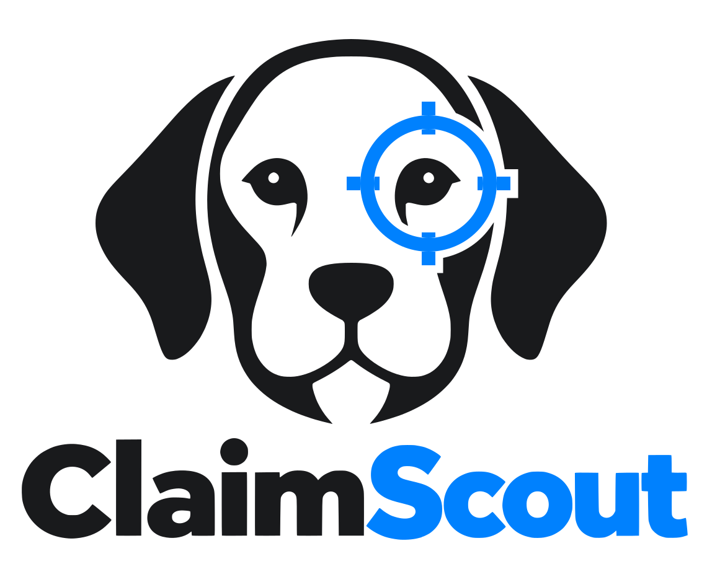

<p align="center"></p>

# ClaimScout

Find class action settlements you may qualify for, find the proof in your own email, and keep track of your
claims. It runs on your PC, with an Android companion app. It's free and open source, with no account, no
subscription and no paid APIs.

```
┌──────────── Your PC: ClaimScout server ──────────┐          ┌──── Android app ───────────┐
│ Collectors → open settlements (public sources)   │          │ "You may qualify" alerts   │
│ Matcher    → keyword rules + optional AI         │ ◄──────► │ Deadlines, claim forms     │
│ AI         → model on this PC, or OpenRouter     │  HTTPS,  │ Gmail / Outlook search     │
│ Proof      → reads the emails the phone found    │  pinned  │   for proof (on the phone) │
│ Tracker    → claims, numbers, payouts (SQLite)   │  cert    │ Claim tracker              │
└──────────────────────────────────────────────────┘          └────────────────────────────┘
```

## How it works

1. **Collect.** Every 6 hours the PC reads the public lists of open settlements from Top Class Actions,
   ClassAction.org and OpenClassActions, plus any community lists you add (plain JSON files; see below). The same
   settlement listed on several sites is merged into one. It keeps the eligibility rules, proof requirements,
   deadline and the official administrator's claim link.
2. **Match.** Your profile lists the companies and products you've used and the states you've lived in. Keyword
   rules rule out state-only settlements and flag the obvious matches. If AI is on, the model reads each remaining
   settlement against your profile and writes an email search plan: which senders and keywords to look for, and
   over what dates.
3. **Find proof.** On the phone, tap **Find proof in my email**. The phone searches your connected Gmail/Outlook
   (read-only) with that plan and sends only the matching emails (trimmed) to your PC. The AI picks out what
   proves something: order numbers, dates, amounts, breach notices. Without AI, simple patterns do it.
4. **File.** **Open claim form** takes you to the official settlement site. You fill it in and submit it yourself.
   ClaimScout never submits claims: they are sworn under penalty of perjury, and only you can say you qualify.
5. **Track.** Mark a claim as filed with its confirmation number, then update it to approved, paid or denied.

## Install the PC server (Linux, macOS, Windows/WSL)

```bash
git clone https://github.com/TheWiderLensInitiative/claimscout ~/claimscout
cd ~/claimscout/server
python3 -m venv .venv && .venv/bin/pip install -r requirements.txt   # or: uv venv && uv pip install -r requirements.txt
.venv/bin/python -m claimscout serve
```

* Dashboard: `.venv/bin/python -m claimscout open` (http://127.0.0.1:8788, only reachable from this PC)
* Phone API: https on port 8787 (allow it through your firewall for your home network)
* Run at login: `cp systemd/claimscout.service ~/.config/systemd/user/ && systemctl --user enable --now claimscout`

Fill in **Profile** on the dashboard, then pair the phone from the **Phone** tab.

### AI (optional)

Under **AI & sources** on the dashboard:

| Choice | Cost | Privacy |
|---|---|---|
| **Model on this PC**: llama.cpp `llama-server`, Ollama (`http://127.0.0.1:11434/v1`), LM Studio | free | nothing leaves the PC |
| **OpenRouter** with a `:free` model (use “List free OpenRouter models”) | free, rate-limited | settlement text and the email excerpts go to OpenRouter and the model's host; free models may log prompts |
| **Off** | free | keyword rules only |

Any OpenAI-compatible endpoint works. A 7B–30B instruct model is plenty.

## The Android app

Build it with `cd android && ./gradlew assembleDebug` (needs JDK 17+ and the Android SDK), or grab the APK from
Releases. To pair, scan the QR code on the dashboard's **Phone** tab with your camera, or paste the link.

* **Gmail:** uses an [app password](https://myaccount.google.com/apppasswords) over IMAP and searches with
  Gmail's own syntax. No Google Cloud project is needed, and there's no 100-user cap on unverified apps.
* **Outlook / Hotmail / Microsoft 365:** uses Microsoft Graph, read-only, with code sign-in. It needs a free app
  registration once ([docs/OUTLOOK.md](docs/OUTLOOK.md)). Whoever builds the APK can set it in
  `android/gradle.properties` so users never see this step.
* Away from home: install [Tailscale](https://tailscale.com) on the PC and phone. The pairing link includes the
  Tailscale address automatically.

## Community settlement lists

Anyone can publish a list (a JSON file in a GitHub repo works) and anyone can subscribe to it under
**AI & sources**:

```json
[{"id": "acme-widget-2026", "title": "Acme Widget settlement", "claim_url": "https://acmesettlement.com/claim",
  "eligibility": "U.S. residents who bought an Acme Widget between Jan 1, 2020 and Dec 31, 2023.",
  "proof": "None", "proof_needed": 0, "deadline": "2026-12-31", "award": "Up to $50", "states": []}]
```

Only `http(s)` links are accepted.

## Privacy

Everything ClaimScout knows about you stays in `~/.local/share/claimscout` on your PC. On the phone, email
passwords and tokens are sealed with an Android Keystore key and excluded from backups. Email is searched from the
phone, read-only. Only matching messages, cut to 4,000 characters each, go to your PC over HTTPS pinned to your
PC's own certificate. The PC stores the extracted facts (date, amount, order number, a one-line summary), not
the emails. Nothing goes to any server of ours, because there isn't one. The single exception is if you choose
OpenRouter for AI.

## Not legal advice

ClaimScout isn't a law firm or a settlement administrator. Listings come from public sources and can be wrong
or out of date, so always read the official notice. Only file claims you qualify for.

## Brand

`brand/source/logo-original.png` is the original artwork. `brand/make_brand.py` traces it into the SVG logos
(`logo`, `logo-dark`, `mark`, `mark-dark`, `mark-mono`, `icon`), the Android launcher, themed, notification and
in-app drawables, and the dashboard mark. Colors: blue `#0081FE`, ink `#191A1C`. Buttons use `#0066CC` (light) and
`#4DA3FF` (dark) so their text meets WCAG AA.

## Development

```bash
cd server && .venv/bin/python -m pytest -q
```

Created by DevIgnite × The Wider Lens Initiative Project · Apache 2.0
